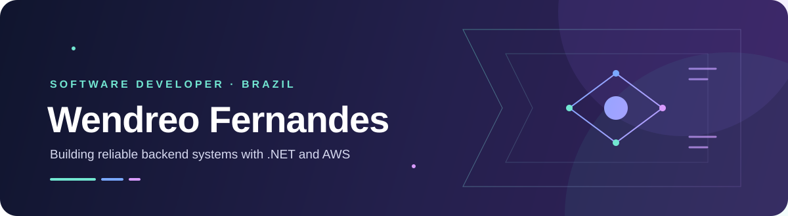

## 👋 About me

Backend-focused software developer building reliable products since 2016. I work at **Webmotors**, designing and improving .NET services and cloud-native systems on AWS. My background includes marketplace and fintech products, distributed systems, and mobile apps.

Previously at **Credisan**, I worked on Flutter apps and financial features including Pix, Open Finance, and DDA.

## ⚡ What I've worked with

## 🚀 Recent work

- Architected and scaled Webmotors backend services supporting thousands of users, improving API performance and reliability.
- Built the Web Store Wallet and contributed purchase, invoice discount, and balance exchange features.
- Delivered Cockpit features, subscription workflows, Databricks visualizations, and CI/CD improvements.
- Recognized with the **Legacy Award · Innovation Category** in Financial Year 2025.

## 🎓 Education

<table>
<tr>
<td width="50%" valign="top">
  <b>🎓 Database Administration</b> 
  Graduate Certificate · FAMEF · 2025
</td>
<td width="50%" valign="top">
  <b>☁️ Cloud Computing</b> 
  Graduate Certificate · Senac SP · 2022–2023
</td>
</tr>
<tr>
<td width="50%" valign="top">
  <b>📱 Mobile Applications Development</b> 
  Graduate Certificate · IFSP · 2018–2019
</td>
<td width="50%" valign="top">
  <b>💻 Systems Analysis and Development</b> 
  Technologist Degree · UNIFEOB · 2016–2018
</td>
</tr>
</table>

## 🧭 How I approach engineering

<table>
<tr>
<td width="33%" align="center"><b>🛡️ Reliability</b> Build systems people can depend on.</td>
<td width="33%" align="center"><b>🧹 Maintainability</b> Keep solutions clear and easy to evolve.</td>
<td width="33%" align="center"><b>📈 Performance</b> Measure, find bottlenecks, and improve.</td>
</tr>
</table>
